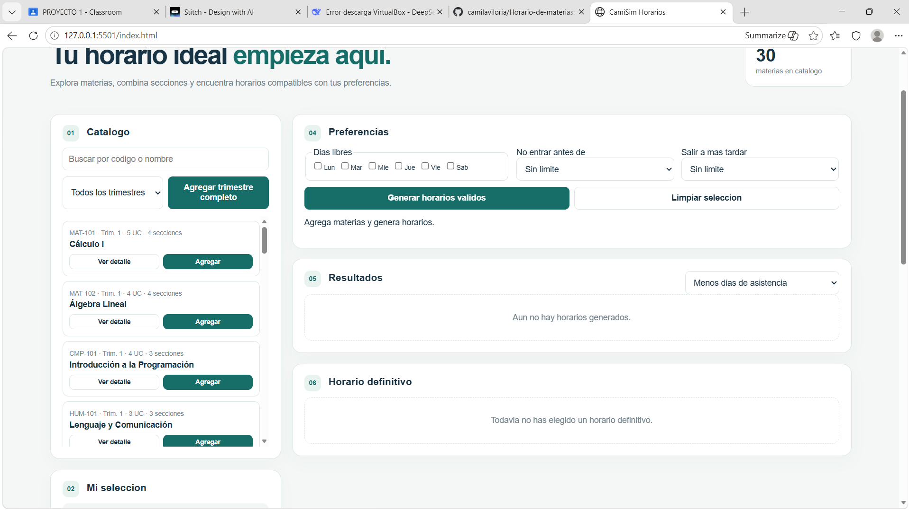
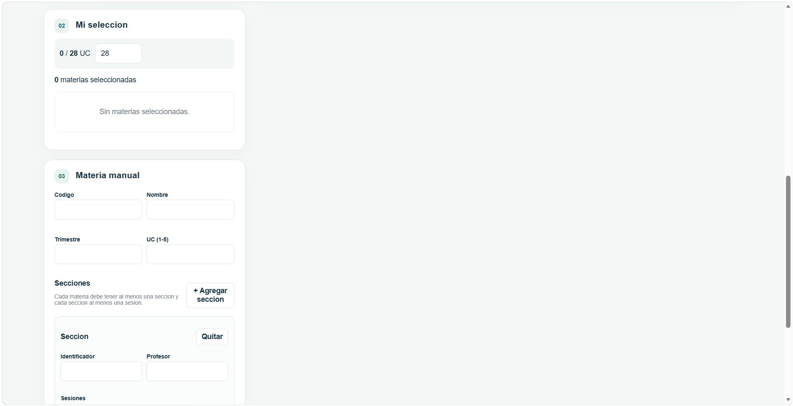
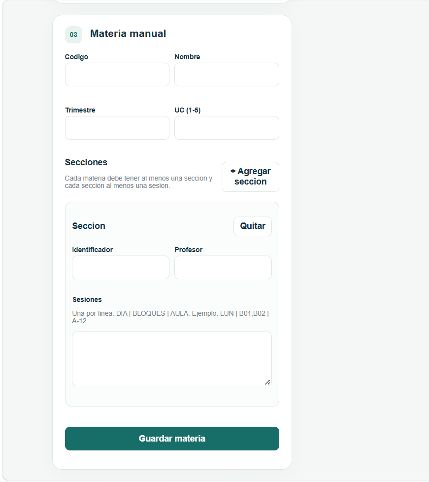
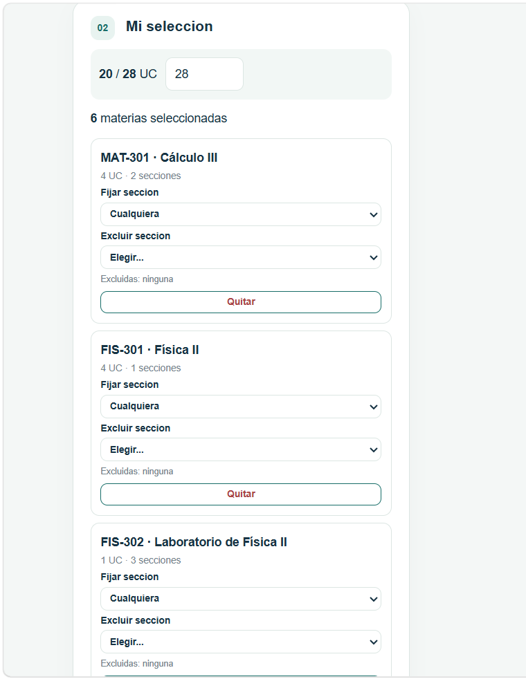
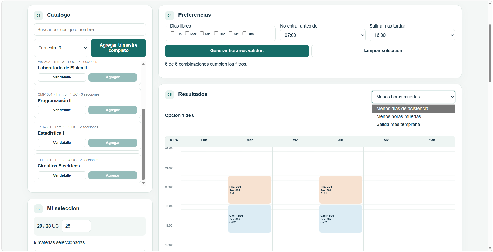
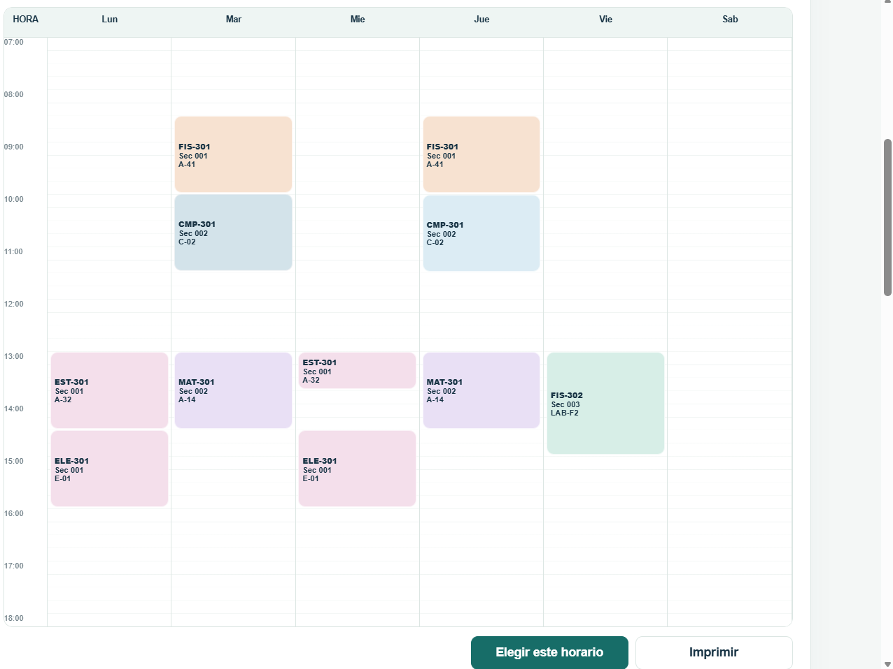
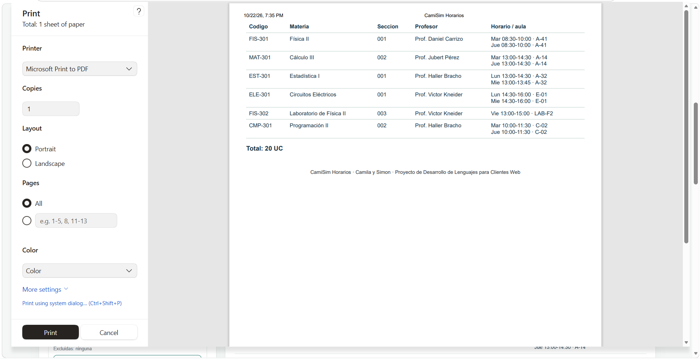

# CamiSim Horarios

## 📌 Nombre original y descripción de la aplicación
**CamiSim Horarios** es una aplicación web interactiva diseñada para la planificación académica. Permite a los estudiantes explorar un catálogo de materias, combinar secciones, gestionar límites de Unidades de Crédito (UC) y generar horarios óptimos que se adapten a sus preferencias personales (días libres, horas de entrada y salida). La herramienta incluye un algoritmo de backtracking para encontrar combinaciones válidas sin choques de horario, y permite exportar el horario final a una vista imprimible.

## 👥 Integrantes y división del trabajo
*   **Integrante 1:** [Simon Chourio]
    *   *División del trabajo:* [Diseño de la interfaz de usuario (HTML/CSS), maquetación de la rejilla del horario, lógica de impresión y formularios dinámicos].
*   **Integrante 2:** [Camila Viloria]
    *   *División del trabajo:* [Lógica del generador de horarios, gestión del estado de selección, validación de choques y documentacion].

## 🚀 Instrucciones para ejecutar el proyecto
1. Clona este repositorio o descarga los archivos en tu computadora.
2. Abre la carpeta del proyecto.
3. Busca el archivo `index.html` y ábrelo con tu navegador web preferido (Chrome, Firefox, Edge, etc.).
4. **Alternativa (Recomendada):** Si usas Visual Studio Code, puedes usar la extensión **Live Server**. Haz clic derecho sobre `index.html` y selecciona "Open with Live Server". (El proyecto ya incluye un archivo `settings.json` configurado en el puerto 5501 para facilitar esto).

## 📊 Criterios de ordenamiento y métricas mostradas
La aplicación calcula y muestra cuatro métricas clave para cada horario generado:
1.  **Días de asistencia:** Cuántos días a la semana tienes que ir a la universidad.
2.  **Horas muertas (Huecos):** El tiempo total de espera entre clases en un mismo día.
3.  **Entrada más temprana:** La hora a la que empiezas tu primer día de clases.
4.  **Salida más tardía:** La hora a la que terminas tu último día de clases.

**Criterios de ordenamiento disponibles:**
*   **Menos días de asistencia:** Prioriza horarios que concentren las materias en la menor cantidad de días posibles.
*   **Menos horas muertas:** Prioriza horarios donde las clases estén pegadas (sin espacios libres entre ellas).
*   **Salida más temprana:** Prioriza horarios donde el promedio de salida diaria sea más temprano.

## 🎨 Decisiones de diseño

*   **Paleta de colores:** Se eligió una paleta basada en tonos verde-teal (`#176d68`), grises azulados (`#173344`, `#142d3d`) y fondos claros (`#f4f7f6`). Esto transmite profesionalismo, calma y claridad visual, ideal para una herramienta académica. Los colores de las materias en la rejilla son pasteles suaves para no fatigar la vista.
*   **Tipografías:** Se utilizó una tipografía sans-serif estándar (`Arial`, `sans-serif`). Es altamente legible en pantallas y asegura una carga rápida sin depender de fuentes externas.
*   **Criterio de iconografía:** Se optó por un diseño minimalista sin íconos gráficos complejos (no se usaron librerías como FontAwesome). En su lugar, se utilizan números (`01`, `02`, `03`...) en fondos redondeados para enumerar los pasos del flujo de trabajo (Catálogo, Selección, Materia Manual, etc.), guiando al usuario de forma intuitiva.
*   **Inspiración:** El diseño se inspiró en paneles de control modernos (dashboards) y herramientas de gestión de proyectos como Notion o Trello, priorizando la usabilidad, el espaciado (uso de *cards* o tarjetas) y la retroalimentación visual inmediata (mensajes de éxito/error).

## 📸 Capturas de pantalla

### 1. Vista principal y Catálogo

*(Muestra el catálogo de materias, la selección y el panel de preferencias)*

### 2. Generación de horarios

*(Muestra la rejilla con el horario generado, las métricas y los botones de navegación)*

### 3. Vista imprimible (Print CSS)

*(Muestra cómo se ve el horario definitivo al usar el botón de Imprimir)*